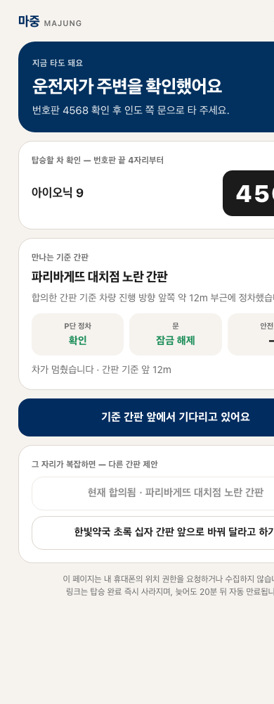
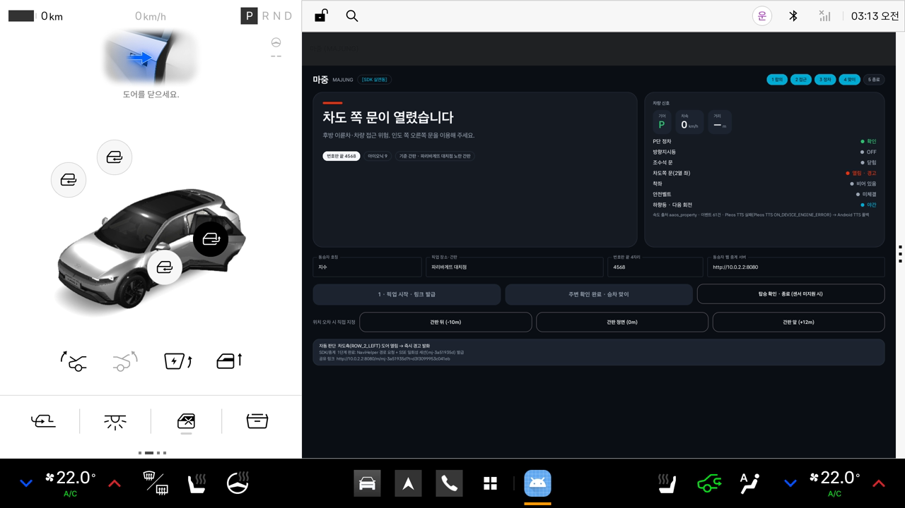

# 마중 (MAJUNG) — 폰은 모르고 차만 아는 3가지로 끝내는 안심 픽업

> 블라인드 심사 준수: 이 저장소에는 참가자의 성명·소속·연락처가 없습니다.

**한 줄 설명:** 학원가·역 앞 픽업의 마지막 100m에서, 스마트폰 위치 공유가 알 수 없는 세 가지 — 차가 정말 P단에 멈췄는지, 동승자가 어느 문을 열었는지, 안전벨트를 맸는지 — 를 Pleos Vehicle SDK 신호로 확인해 동승자 웹에 "지금 타도 돼요"를 알리고, 벨트 체결과 동시에 위치 공유를 스스로 끝내는 Pleos Connect 차량용 앱.

| 폰은 모른다 | 차는 안다 (Vehicle SDK 신호) | 마중이 하는 일 |
| :-- | :-- | :-- |
| 차가 정말 멈췄는지 | `Gear = PARK` + 차속 0 (AAOS `PERF_VEHICLE_SPEED`) | 그때서야 동승자 웹이 **"지금 타도 돼요"** 로 바뀐다 (차속 0이어도 D단이면 안 바뀜 — 테스트로 보장) |
| 동승자가 어느 문을 열었는지 | `DoorPosition(ROW_2_LEFT)` 열림 | 차도 쪽 문이면 **즉시 실내 음성 경고** (운전 부하 게이트 우회) |
| 안전벨트를 맸는지 | `SeatBeltBuckled` + 문 닫힘 | 공유 링크를 **자동 파기**하고 창문·독서등·공조를 세션 전 상태로 원복 |

운전자가 직접 누르는 버튼은 **"주변 확인 완료 · 승차 맞이" 하나**뿐이며, 그것도 P단 정차가 아니면 거부됩니다. 접근 알림·정차 확인·사전 공조·환대 인사·종료는 전부 차량 신호가 트리거합니다.

![Pleos Connect v2.1.0 에뮬레이터 · pleos 빌드 [SDK 실연동] · 착좌 감지 환대 (실제 Vehicle SDK 콜백)](docs/screenshots/pleos_emulator_step5_welcome.png)

<p> </p>

**시연 영상:** `docs/demo/majung_demo.mp4` (약 2분 · 1080p). ① **Pleos Connect v2.1.0 전용 에뮬레이터에서 pleos 빌드 실녹화** — Virtual Console로 주입한 실제 Vehicle SDK 콜백(도어·착좌·하향등)과 실제 제어 호출(도어 잠금 해제·창문·독서등 `onComplete`) ② 위치 기반 자동 접근·정차 판정(Android Automotive 에뮬레이터 시뮬레이션 주행) ③ 동승자 웹 실시간 중계 상태 재생 + 모션 그래픽 해설·내레이션. 재현: `tools/demo-video/render.mjs`

**Pleos Connect 에뮬레이터 검증 기록:** [`docs/verification/pleos_emulator_evidence.md`](docs/verification/pleos_emulator_evidence.md) (SDK 등록 16건 · 콜백 수신 · 제어 onComplete · 능력 조회 결과 · 에뮬레이터 제약과 대응), 원본 로그 `docs/verification/pleos_emulator_logcat_demo.txt`

---

## 1. 6단계 흐름과 트리거 신호

| 단계 | 트리거 | 차량 → 동승자 웹 / 차량 제어 | 사용 API |
| :-- | :-- | :-- | :-- |
| 1 합의 | 운전자 "픽업 시작" (또는 Gleo 음성 `START_SAFE_PICKUP`) | 기준 간판·차종·번호판 끝 4자리·일회성 링크(최대 20분) | `NaviHelper.requestRoute(WithWaypoints)`, `CarInfo.getVINInfo` |
| 2 접근 | 반경 80m + ≤25km/h + 우측 방향지시등 (또는 50m 저속 폴백) | "차가 들어오고 있어요" + 10m 단위 거리 · **도착 전 사전 공조**(유아 카시트 좌석 열선 0 고정) | `FusedLocation.registerFusedLocationCallback`, `TurnSignal.register…`, `HVAC.setHvacFanSpeed/Temperature`, `Seat.setHvacSeatTemperature` |
| 3 식별 | — | 차종(VIN) + 번호판 끝 4자리 상시 노출 | `CarInfo.getVINInfo` (실패 시 운전자 입력) |
| 4 정차 | **기어 P + 차속 0** + 60m 이내 | "차가 멈췄어요" + 간판 기준 앞/뒤 m (신뢰도 ≥0.70일 때만, 아니면 운전자 원탭 [간판 앞/정면/뒤]) | `Gear.registerGearSelection`, `FusedLocation` confidence |
| 5 맞이 | 운전자 [주변 확인 완료] → 문 열림 → 착좌 | 잠금 해제·창문 25%(와이퍼 작동 시 0%)·하향등 ON일 때 독서등·"○○님, 반갑습니다" | `Door.setDoorLock`, `Window.setWindowPosition`, `Light.setReadingLightSwitch`, `Light.registerLowBeamLightState`, `Seat.registerSeatOccupancy`, Pleos `TextToSpeech` |
| 6 종료 | **문 닫힘 + 벨트 체결** (센서 미지원 트림은 수동 버튼) | 링크 즉시 파기(`DELETE`), 20분 TTL 백업, 창문·조명·공조 원복 | `Seat.registerSeatBeltBuckledState`, `Door.registerDoorPosition` |

안전 인터락 (항상 동작):
- 뒷좌석 차도 쪽(`ROW_2_LEFT`) 문 열림 → CRITICAL 음성 경고
- 5단계 중 기어 D/R 전환 시 문 열림·벨트 미체결이면 출발 위험 경고
- 운전 부하 지수(조향 각속도·브레이크·와이퍼·속도·NaviHelper TBT 다음 회전 거리) ≥ 0.45 이면 일반 안내 보류, 1.5초 안정 후 재생
- 원격 도어 **개방**은 하지 않음. 잠금 해제만, P단 + 운전자 확인 후에만.
- 동승자 폰 GPS 미수집. 차량 원시 좌표는 중계 서버가 폐기하고 10m 버킷 거리만 전달.

---

## 2. 코드가 실제로 하는 것 (README 주장 ↔ 소스 대응)

| 주장 | 파일 | 근거 |
| :-- | :-- | :-- |
| Vehicle SDK `register*` 콜백 14종 실제 등록 | `app/src/pleos/.../PleosRealSdkBindings.kt` `registerTelemetryCallbacks` | gear·brake·steering·wiper(FRONT_WINDSHIELD)·turnSignal·lowBeam·door×4·seatOccupancy×3·seatBelt×3 + 초기값 `getCurrent*` 조회 |
| 트림별 능력 조회 | 같은 파일 `probeCapabilities()` | `checkSeatBeltBuckled/SeatOccupancy/DoorPosition/DoorLock/WindowPosition/HvacFanSpeed/HvacTemperature/HvacRecirculation/SeatTemperatureCapabilities` → AccessType이 WRITE가 아니면 제어 생략, 센서 없는 트림은 수동 종료 모드. **DOOR_LOCK은 지원 영역 목록에서 조수석을 포함한 영역(Pleos 에뮬레이터: 4도어 묶음)을 선택, WINDOW_POS는 AreaBounds(0..10)로 % 환산** — 에뮬레이터에서 `onComplete` 확인 |
| 공조 사전 설정 → 원복 | `vehicle/PleosCapabilityGateway.kt` + 위 바인딩 | `get/setHvacFanSpeed`, `get/setHvacTemperature(CELSIUS)`, `get/setHvacRecirculation`, `get/setHvacSeatTemperature` — 스냅샷 후 세션 종료 시 되돌림 |
| 차속은 AAOS 표준 속성 | `app/src/main/.../vehicle/AaosSpeedSource.kt` | `CarPropertyManager.registerCallback(PERF_VEHICLE_SPEED, SENSOR_RATE_UI)`; 실패 시 FusedLocation 좌표 변화로 추정 (에뮬레이터에서 실동작 확인) |
| 다음 회전 거리 → 운전 부하 | `PleosNaviSdkGateway` `NaviHelperEventListener.onTBTInfo` | `TBTInfo.distance` → `DrivingLoadSnapshot.nextTbtDistanceMeters` |
| 신호 → 상태 → 자동 전이 | `vehicle/VehicleSignalHub.kt` → `orchestrator/SignalDrivenPickupCoordinator.kt` | Hub가 StateFlow로 합치고(조향 각속도·추정 차속 계산), Coordinator가 edge-trigger로 6단계 전진 |
| 동승자 웹이 받는 차량 사실 | `model/MajungModels.kt` `VehicleFacts`, `relay-server/server.mjs` sanitize 목록 | 차량 원시 좌표는 서버가 버리고 10m 버킷 거리만 통과 |
| TTS 안전망 | `audio/AndroidPlatformTtsAdapter.kt` `FallbackTtsEngine` | Pleos TTS(ON_DEVICE) 실패 시 Android TTS로 같은 문장 재생 |
| 시뮬레이션은 같은 경로 | `app/src/sim/.../SimSdkBindings.kt` `SimDriveScenario` | 리스너 인터페이스에 신호를 주입할 뿐, 앱 로직은 pleos 플레이버와 동일 |

**현재 범위에서 하지 않는 것**: 앰비언트 조명, STT(의존성에서도 제거), 키즈폰 SMS 실발송(서버 스텁).

---

## 3. 검증 (이 저장소에서 재현 가능)

```bash
node relay-server/verify_e2e_sse.mjs          # 중계 서버 E2E: GPS 필드 차단 · VehicleFacts 통과 · SSE · DELETE 파기
./gradlew :app:testSimDebugUnitTest           # 유닛 테스트 15건
./scripts/verify_and_build_apk.sh             # 위 두 가지 + sim/pleos release APK 생성
```

`app/src/test/.../SignalDrivenPickupCoordinatorTest.kt`가 보장하는 것:
- 멀리서 깜빡이만 켜면 접근 알림이 **안 나가고**, 80m·감속·우측 깜빡이가 모이면 나간다
- 차속 0이어도 **D단이면 4단계로 안 넘어가고**(3초 주기 위치 재전송에도), P단이 되면 넘어가며 웹에 `stoppedInPark=true`가 실린다
- 주행 중 "승차 맞이"는 거부, P단에서는 잠금 해제 + 창문 25%, 우천 시 창문 0%
- 차도 쪽 문 열림 → 즉시 경고 발화
- 문 열림 → (하향등 ON일 때만) 독서등, 착좌 → 인사, 문 닫힘만으로는 종료 안 됨, **벨트 체결 → 자동 파기**
- 문 열린 채 D단 → 출발 위험 경고
- 접근 시 사전 공조(풍량 3, 카시트 열선 0) → 종료 시 원복(풍량 2, 열선 1)
- 다음 회전 100m + 제동 중에는 접근 안내가 보류되고, 회전이 끝나면 재생
- AAOS 차속이 없으면 FusedLocation 좌표로 36 km/h 추정

---

## 4. 실행 방법 · 테스트 환경

### 4-1. 중계 서버 + 동승자 웹 (Node 18+, 외부 의존성 없음)
```bash
PORT=8080 node relay-server/server.mjs
# 에뮬레이터는 http://10.0.2.2:8080 으로 자동 연결, 브라우저는 http://localhost:8080/m/<sessionId>
```

### 4-2. Pleos Connect Emulator — pleos 플레이버 (검증 완료)
- 검증 환경: **Pleos Connect Emulator v2.1.0** (`system-images;android-34;pleos_car_emulator;arm64-v8a`, Android API 34, Cold boot, RAM 4GB, 화면 2560×1440 @160dpi, `-gpu host`, macOS Apple Silicon)
- 이미지 설치: `./scripts/install_pleos_emulator_image.sh` (공식 SDK Update Site 등록 + 42dot SDK 라이선스 동의 + 4.67GB 다운로드) → `avdmanager create avd -n pleos_connect -k "system-images;android-34;pleos_car_emulator;arm64-v8a" -d Pleos_Connect_v2_0`
- `apk/majung-v2-pleos-release.apk` 설치 → 첫 실행 시 `android.car.permission.CAR_SPEED`(위치 그룹) 권한 허용
- Virtual Console(`adb forward tcp:8088 tcp:8088` → 127.0.0.1:8088)로 기어·차속·도어·착좌·하향등·와이퍼·방향지시등을 주입하면 화면 우측 "차량 신호" 패널과 동승자 웹이 즉시 반응. 화면이 꺼지면 Virtual Console에서 Power System 상태를 `On`으로 두세요.
- 확인된 것: SDK `register*` 16건 등록, 콜백 수신(기어·차속·브레이크·조향·방향지시등·하향등·와이퍼·도어·착좌), 제어 `onComplete`(도어 잠금 해제·창문·독서등), NaviHelper 경로 요청·TBT 수신, 능력 조회. 제약(벨트 신호·위치 주입 불가, TTS 엔진 미탑재, 착좌 값 반전)은 `docs/verification/pleos_emulator_evidence.md` 4절.
- SDK: Vehicle 2.3.2 · NaviHelper 3.0.5 · FusedLocation 1.1.3 · TextToSpeech 3.3.1 (`nexus-playground.pleos.ai` 실제 배포 버전)

### 4-3. Android Automotive OS 에뮬레이터 / 일반 AVD — sim 플레이버
- 검증 환경: **Android Automotive OS API 33 (arm64), AVD 2560×1440 @160dpi, RAM 4GB** — 위치 기반 자동 접근·정차 판정까지 포함한 6단계 전체를 실행·녹화했습니다(Pleos 에뮬레이터는 위치 주입이 안 되어 이 부분은 sim으로 시연).
- `apk/majung-v2-sim-release.apk` 설치 후 화면 하단 **시뮬레이션** 행: "주행 → 간판 앞 P단 정차" → "주변 확인 완료 · 승차 맞이" → "차도 쪽 문 잘못 열림"(선택) → "동승자 탑승(문·착좌·벨트)". 모두 리스너 주입이라 pleos와 같은 코드가 돕니다.
- 1600dp 이상 폭에서는 레이아웃을 비례 확대하고(`MainActivity.kt` `iviScale`), 상단 카드 높이를 고정해 **버튼 위치가 주행 중 움직이지 않습니다**.

### 4-4. 빌드 환경
JDK 17 · Android SDK API 34 · Gradle 8.10.2(wrapper 포함) · minSdk 28 / targetSdk 34 · Kotlin 2.0.21 · Compose BOM 2024.10.01. pleos 플레이버 빌드는 `nexus-playground.pleos.ai` 접근이 필요합니다.

---

## 5. 디자인

- **차량 화면**: Pleos(ccNC) 다크 IVI 언어 — 검정 바탕, 한 화면 한 메시지(40sp 헤드라인), 현대 브랜드 블루 계열 포인트, 환대 순간만 Sand(#E4DCD3) 카드. 터치 타깃 ≥ 56dp, UX 제한 시 입력란 숨김. 토큰: `ui/MajungTheme.kt`
- **동승자 웹**: 현대 브랜드 라이트 톤(Hyundai Blue #002C5F / Sand). 번호판 끝 4자리가 화면에서 가장 큰 요소. 상태 카드는 오직 차량 신호로만 바뀐다. `web-companion/index.html`
- 로고·전용 서체 등 상표 자산은 사용하지 않았습니다.

---

## 6. 구조

```text
app/src/main/kotlin/io/majung/pleos/
├── vehicle/VehicleSignalHub.kt          # SDK/AAOS/FusedLocation 콜백 → 단일 StateFlow (조향 각속도·추정 차속·TBT·하향등)
├── vehicle/AaosSpeedSource.kt           # CarPropertyManager PERF_VEHICLE_SPEED
├── vehicle/PleosCapabilityGateway.kt    # 능력 매트릭스·공조 스냅샷/원복·도어/착좌/벨트 시퀀스 추론·출발 위험 판정
├── orchestrator/SignalDrivenPickupCoordinator.kt   # 신호 edge → 6단계 자동 전진 (유일한 수동: 주변 확인)
├── orchestrator/PickupEtaOrchestrator.kt           # 세션·티켓·VehicleFacts 발행·즉시 파기
├── safety/DrivingLoadGate.kt            # 운전 부하 지수 게이트
├── finder/CurbsideCarFinderEngine.kt    # 접근 복합 조건·간판 오프셋·거리
├── welcome/WelcomeHospitalityEngine.kt  # 환대 단계 결정
├── audio/                               # 오디오 포커스(MAY_DUCK)·Pleos TTS → Android TTS 폴백
├── relay/EphemeralRelayClient.kt        # SSE/REST (OkHttp)
└── ui/MainActivity.kt · MajungTheme.kt  # Compose IVI 화면
app/src/pleos/…/PleosRealSdkBindings.kt  # Vehicle 2.3.2 · NaviHelper 3.0.5 · FusedLocation 1.1.3 · TTS 3.3.1
app/src/sim/…/SimSdkBindings.kt          # 인메모리 구현 + 시나리오 재생기
relay-server/server.mjs · verify_e2e_sse.mjs
web-companion/index.html
tools/demo-video/                        # 시연 영상 렌더 파이프라인 (녹화 + SSE 타임라인 → 합성)
tools/submission/fill_official_form.py   # 공식 접수양식 DOCX 02 섹션 채우기
docs/submission/                         # 접수양식 DOCX · 제출 체크리스트
```

---

## 7. APK · 제출물 위치

- `apk/majung-v2-pleos-release.apk` — Pleos Connect 에뮬레이터용 (Vehicle SDK 실연동)
- `apk/majung-v2-sim-release.apk` — Android Automotive / 일반 AVD 시연용 (`applicationId io.majung.pleos.sim`)
- `docs/demo/majung_demo.mp4` — 시연 영상
- `docs/submission/마중_접수양식_v3.docx` — 공식 접수양식(02 심사 자료 작성본)
- 두 APK 모두 debug 키 서명으로 별도 키 없이 설치됩니다. 재빌드: `./scripts/verify_and_build_apk.sh`
