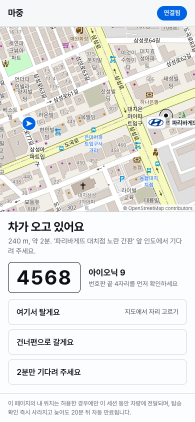
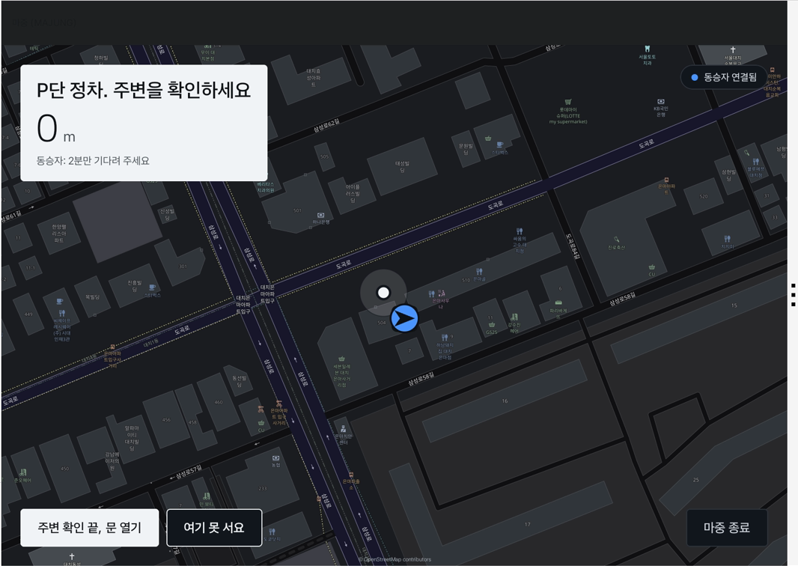
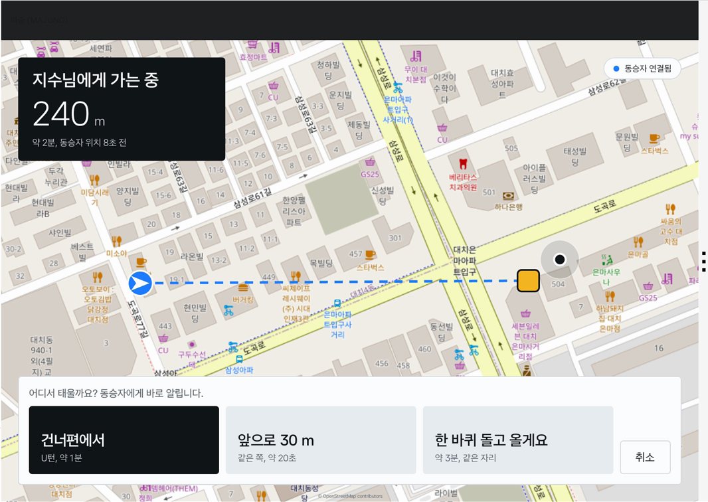
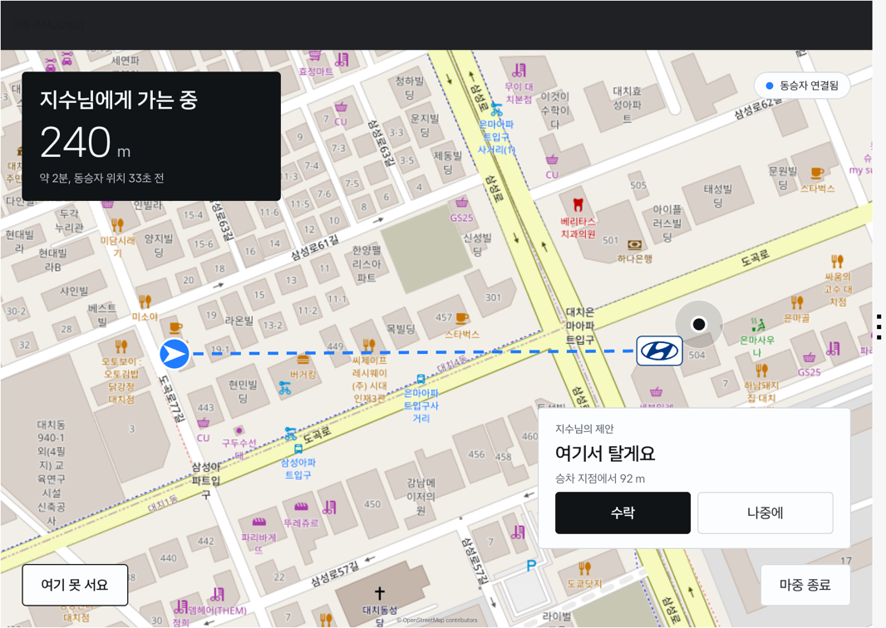

# 마중 (MAJUNG) — 폰은 모르고 차만 아는 3가지로 끝내는 안심 픽업

> 블라인드 심사 준수: 이 저장소에는 참가자의 성명·소속·연락처가 없습니다.

**한 줄 설명:** 학원가·역 앞 픽업의 마지막 100m에서, 차와 동승자가 **한 지도에서 서로를 보고**, 스마트폰 위치 공유가 알 수 없는 세 가지 — 차가 정말 P단에 멈췄는지, 동승자가 어느 문을 열었는지, 안전벨트를 맸는지 — 를 Pleos Vehicle SDK 신호로 확인해 동승자 웹에 "지금 타도 돼요"를 알리고, 벨트 체결과 동시에 위치 공유를 스스로 끝내는 Pleos Connect 차량용 앱.

**화면은 지도 하나, 할 일 하나 (v3):**
- **차량 화면** — 지도 위에 동승자 위치·내 차·승차 지점만. 가는 동안 누를 버튼은 **[여기 못 서요]** 하나(건너편(U턴) / 앞으로 30 m / 한 바퀴 → 승차 지점 이동 + NaviHelper 재경로 + 동승자 웹 즉시 반영), 멈춘 뒤에는 **[주변 확인 끝, 문 열기]** 하나. 동승자의 간편 제안은 카드로 도착해 [수락]/[나중에]. 동승자가 지도에서 고른 자리는 수락 전까지 차량 지도에 마중 심볼로 보입니다. 차량 신호·로그는 연결 칩을 눌러 여는 진단 창으로 옮겼습니다.
- **동승자 웹** — 지도(차·나·승차 지점), 번호판 끝 4자리, 간편 제안 세 개("여기서 탈게요"는 지도를 움직여 탈 자리를 핀에 맞춘 뒤 보내며 그 좌표가 차량에 전달됨, "건너편으로 갈게요", "2분만 기다려 주세요"). 차가 P단에 서면 "지금 타도 돼요"로 바뀝니다.
- 디자인은 Pleos Connect 런처의 결(밝은 바탕, 검은 판, 작은 라운드, 얇은 선, 시스템 서체)을 따르고 하향등이 켜지면 밤 토큰으로 바뀝니다. 세 가지 후보를 비교한 시안: [`docs/design/`](docs/design/README.md)

| 폰은 모른다 | 차는 안다 (Vehicle SDK 신호) | 마중이 하는 일 |
| :-- | :-- | :-- |
| 차가 정말 멈췄는지 | `Gear = PARK` + 차속 0 (AAOS `PERF_VEHICLE_SPEED`) | 그때서야 동승자 웹이 **"지금 타도 돼요"** 로 바뀐다 (차속 0이어도 D단이면 안 바뀜 — 테스트로 보장) |
| 동승자가 어느 문을 열었는지 | `DoorPosition(ROW_2_LEFT)` 열림 | 차도 쪽 문이면 **즉시 실내 음성 경고** (운전 부하 게이트 우회) |
| 안전벨트를 맸는지 | `SeatBeltBuckled` + 문 닫힘 | 공유 링크를 **자동 파기**하고 창문·독서등·공조를 세션 전 상태로 원복 |

운전자가 직접 누르는 버튼은 **"주변 확인 끝, 문 열기" 하나**뿐이며, 그것도 P단 정차가 아니면 거부됩니다. 접근 알림·정차 확인·사전 공조·환대 인사·종료는 전부 차량 신호가 트리거합니다.

![Pleos Connect v2.1.0 에뮬레이터 · pleos 빌드 [SDK 실연동] · 접근 중: 지도 위 동승자·내 차·승차 지점](docs/screenshots/pleos_emulator_v3_approach.png)

<p> </p>

<p> </p>

**시연 영상:** `docs/demo/majung_demo.mp4` (약 2분 40초 · 1080p). **Pleos Connect v2.1.0 전용 에뮬레이터에서 pleos 빌드 실녹화**(런처 오른쪽 앱 영역) — Virtual Console로 주입한 실제 Vehicle SDK 콜백(기어·차속·방향지시등·도어·착좌·하향등)과 실제 제어 호출(도어 잠금 해제·창문·독서등 `onComplete`), 동승자 위치·간편 제안·'여기 못 서요' 재경로, 낮/밤 전환, 동승자 웹 실시간 중계 상태 동기 재생 + 모션 그래픽 해설·내레이션. 차량 위치만은 Pleos 에뮬레이터에 주입 수단이 없어 디버그 빌드의 adb 훅으로 넣었습니다(4-2절). 재현: `tools/demo-video/pleos_flow.sh` → `tools/demo-video/render.mjs`

**Pleos Connect 에뮬레이터 검증 기록:** [`docs/verification/pleos_emulator_evidence.md`](docs/verification/pleos_emulator_evidence.md) (SDK 등록 16건 · 콜백 수신 · 제어 onComplete · 능력 조회 결과 · 에뮬레이터 제약과 대응 · v3 지도/위치/제안/재경로 검증), 원본 로그 `docs/verification/pleos_emulator_logcat_demo.txt`(v2) · `pleos_emulator_logcat_v3.txt`(v3 시연), 중계 타임라인 `pleos_emulator_relay_timeline_v3.jsonl`, 단계 시각 `pleos_flow_taps_v3.json`

---

## 0. 심사위원 3분 체험

1. **영상으로 먼저**: [`docs/demo/majung_demo.mp4`](docs/demo/majung_demo.mp4) — Pleos Connect v2.1.0 에뮬레이터 실녹화와 동승자 웹을 나란히, 단계별 SDK 호출 자막.
2. **가장 빠른 실행 (일반 Android 에뮬레이터, 2분)**: `PORT=8080 node relay-server/server.mjs` → `apk/majung-v2-sim-release.apk` 설치 → [픽업 시작, 링크 보내기] → 화면 아래 **[시뮬레이션]**에서 "주행 후 간판 앞 P단 정차" → [주변 확인 끝, 문 열기] → "동승자 탑승". 동승자 웹은 `curl http://127.0.0.1:8080/api/v1/sessions/_latest` 가 주는 `sessionId`·`passengerToken`으로 `http://localhost:8080/m/<sessionId>?t=<passengerToken>&demoLat=37.49893&demoLng=127.06164` 를 브라우저에서 엽니다.
3. **Pleos Connect 에뮬레이터 (실 SDK)**: 위 중계 서버 + `apk/majung-v2-pleos-release.apk` → Virtual Console(127.0.0.1:8088)로 기어 P·차속 0·문·착좌·하향등을 주입하면 차량 화면과 동승자 웹이 즉시 반응합니다. 세부는 4-2절.
4. **코드에서 확인**: 2절의 표(README 주장 ↔ 소스), `node relay-server/verify_e2e_sse.mjs`, `./gradlew :app:testSimDebugUnitTest`(35건), `docs/verification/pleos_emulator_evidence.md`(실제 SDK 로그).

## 1. 6단계 흐름과 트리거 신호

| 단계 | 트리거 | 차량 → 동승자 웹 / 차량 제어 | 사용 API |
| :-- | :-- | :-- | :-- |
| 1 합의 | 운전자 "픽업 시작" (또는 Gleo 음성 `START_SAFE_PICKUP`) | 기준 간판·차종·번호판 끝 4자리·일회성 링크(최대 20분) | `NaviHelper.requestRoute(WithWaypoints)`, `CarInfo.getVINInfo` |
| 2 접근 | 반경 80m + ≤25km/h + 우측 방향지시등 (또는 50m 저속 폴백) | 지도에 내 차·동승자·승차 지점, "차가 오고 있어요" + 거리 · **도착 전 사전 공조**(유아 카시트 좌석 열선 0 고정) · 운전자 [여기 못 서요] → 건너편(U턴)/앞으로 30 m/한 바퀴 → 승차 지점 이동 + 재경로 · 동승자 간편 제안(지도에서 고른 자리 포함) → [수락]/[나중에] | `FusedLocation.registerFusedLocationCallback`, `TurnSignal.register…`, `NaviHelper.requestRoute`(재경로), `HVAC.setHvacFanSpeed/Temperature`, `Seat.setHvacSeatTemperature` |
| 3 식별 | — | 차종(VIN) + 번호판 끝 4자리 상시 노출 | `CarInfo.getVINInfo` (실패 시 운전자 입력) |
| 4 정차 | **기어 P + 차속 0** + 60m 이내 | "차가 멈췄어요" + 지도상 정차 위치 (Gleo 음성 `SHARE_PICKUP_OFFSET`으로 간판 앞/정면/뒤 지정도 가능) | `Gear.registerGearSelection`, `FusedLocation` confidence |
| 5 맞이 | 운전자 [주변 확인 끝, 문 열기] → 문 열림 → 착좌 | 잠금 해제·창문 25%(와이퍼 작동 시 0%)·하향등 ON일 때 독서등·"○○님, 반갑습니다" | `Door.setDoorLock`, `Window.setWindowPosition`, `Light.setReadingLightSwitch`, `Light.registerLowBeamLightState`, `Seat.registerSeatOccupancy`, Pleos `TextToSpeech` |
| 6 종료 | **문 닫힘 + 벨트 체결** (센서 미지원 트림은 수동 버튼) | 링크 즉시 파기(`DELETE`), 20분 TTL 백업, 창문·조명·공조 원복 | `Seat.registerSeatBeltBuckledState`, `Door.registerDoorPosition` |

안전 인터락 (항상 동작):
- 뒷좌석 차도 쪽(`ROW_2_LEFT`) 문 열림 → CRITICAL 음성 경고
- 5단계 중 기어 D/R 전환 시 문 열림·벨트 미체결이면 출발 위험 경고
- 운전 부하 지수(조향 각속도·브레이크·와이퍼·속도·NaviHelper TBT 다음 회전 거리) ≥ 0.45 이면 일반 안내 보류, 1.5초 안정 후 재생
- 원격 도어 **개방**은 하지 않음. 잠금 해제만, P단 + 운전자 확인 후에만.
- 위치는 **서로 보기 위해서만**: 동승자 위치는 동승자 웹에서 브라우저 권한을 허용한 경우에만 세션 동안 중계 서버 메모리에 머물고(`passengerLocationOptIn`), 차량 위치·승차 지점과 함께 탑승 확인 즉시(`DELETE`) 또는 20분 뒤 삭제됩니다. 디스크·로그에 남기지 않습니다.
- **중계 서버 접근 제어**: 세션 id만으로는 아무것도 읽거나 쓸 수 없습니다. 차량은 세션을 만들 때 자기만 아는 키를 헤더(`X-Majung-Car-Key`)로 등록하고 이후 상태 갱신·제안 응답·파기에 그 키가 필요합니다. 동승자는 공유 링크의 일회성 토큰(`?t=`) 없이는 상태 조회·실시간 스트림·위치 전송·제안을 할 수 없습니다. 키와 토큰은 상태에 섞이지 않아 스트림에 실리지 않으며, 불일치는 403으로 거부됩니다(`relay-server/verify_e2e_sse.mjs`가 거부 경로까지 검증).

---

## 2. 코드가 실제로 하는 것 (README 주장 ↔ 소스 대응)

| 주장 | 파일 | 근거 |
| :-- | :-- | :-- |
| Vehicle SDK `register*` 콜백 14종 실제 등록 | `app/src/pleos/.../PleosRealSdkBindings.kt` `registerTelemetryCallbacks` | gear·brake·steering·wiper(FRONT_WINDSHIELD)·turnSignal·lowBeam·door×4·seatOccupancy×3·seatBelt×3 + 초기값 `getCurrent*` 조회 |
| 트림별 능력 조회 | 같은 파일 `probeCapabilities()` | `checkSeatBeltBuckled/SeatOccupancy/DoorPosition/DoorLock/WindowPosition/HvacFanSpeed/HvacTemperature/HvacRecirculation/SeatTemperatureCapabilities` → AccessType이 WRITE가 아니면 제어 생략, 센서 없는 트림은 수동 종료 모드. **DOOR_LOCK은 지원 영역 목록에서 조수석을 포함한 영역(Pleos 에뮬레이터: 4도어 묶음)을 선택, WINDOW_POS는 AreaBounds(0..10)로 % 환산** — 에뮬레이터에서 `onComplete` 확인 |
| 공조 사전 설정 → 원복 | `vehicle/PleosCapabilityGateway.kt` + 위 바인딩 | `get/setHvacFanSpeed`, `get/setHvacTemperature(CELSIUS)`, `get/setHvacRecirculation`, `get/setHvacSeatTemperature` — 스냅샷 후 세션 종료 시 되돌림 |
| 차속은 AAOS 표준 속성 | `app/src/main/.../vehicle/AaosSpeedSource.kt` | `CarPropertyManager.registerCallback(PERF_VEHICLE_SPEED, SENSOR_RATE_UI)`; 실패 시 FusedLocation 좌표 변화로 추정 (에뮬레이터에서 실동작 확인) |
| 다음 회전 거리 → 운전 부하 | `PleosNaviSdkGateway` `NaviHelperEventListener.onTBTInfo` | `TBTInfo.distance` → `DrivingLoadSnapshot.nextTbtDistanceMeters` |
| 신호 → 상태 → 자동 전이 | `vehicle/VehicleSignalHub.kt` → `orchestrator/SignalDrivenPickupCoordinator.kt` | Hub가 StateFlow로 합치고(조향 각속도·추정 차속 계산), Coordinator가 edge-trigger로 6단계 전진 |
| 동승자 웹이 받는 것 | `model/MajungModels.kt` `VehicleFacts`·`LiveMapState`, `relay-server/server.mjs` sanitize 목록 | 차량 신호 요약 + 지도용 위치(차·승차 지점)만 통과, 세션 메모리에만 보관 |
| 지도 위에서 서로 보기 | `ui/map/MajungMapView.kt`(osmdroid, OSM 타일, 밤에는 색 행렬 필터), `web-companion/index.html`(Leaflet) | 동승자 웹 `POST /passenger-location` → SSE `PASSENGER_LOCATION` → 차량 지도; 차량은 2초 간격으로 `carLat/carLng/carHeadingDeg` 발행 |
| 여기 못 서요 / 간편 제안 | `orchestrator/PickupEtaOrchestrator.kt` `applyCannotStopOption`·`resolvePendingSuggestion`, `finder/GeoMath.kt` | 앞으로 30 m는 진행 방향으로, 건너편은 진행 방향 왼쪽 14 m(우측 통행)로 승차 지점 이동 → `NaviHelper.requestRoute` 재호출 → `pickupVersion` 증가로 동승자 웹 지도 갱신; 제안 수락 시 `POST /suggestion-reply` |
| TTS 안전망 | `audio/AndroidPlatformTtsAdapter.kt` `FallbackTtsEngine` | Pleos TTS(ON_DEVICE) 실패 시 Android TTS로 같은 문장 재생 |
| 시뮬레이션은 같은 경로 | `app/src/sim/.../SimSdkBindings.kt` `SimDriveScenario` | 리스너 인터페이스에 신호를 주입할 뿐, 앱 로직은 pleos 플레이버와 동일 |

**현재 범위에서 하지 않는 것**: 앰비언트 조명, STT(의존성에서도 제거), 키즈폰 SMS 실발송(서버 스텁).

---

## 3. 검증 (이 저장소에서 재현 가능)

```bash
node relay-server/verify_e2e_sse.mjs          # 중계 서버 E2E: 좌표 필드 sanitize · VehicleFacts 통과 · PASSENGER_LOCATION/SUGGESTION · suggestion-reply · SSE · DELETE 파기
./gradlew :app:testSimDebugUnitTest           # 유닛 테스트 35건 (운전 부하 게이트, 좌표 오프셋, 여기 못 서요 3안, 제안 수락/거절, 세션 종료 정리 포함)
./scripts/verify_and_build_apk.sh             # 위 두 가지 + sim/pleos release APK 생성
```

`app/src/test/.../SignalDrivenPickupCoordinatorTest.kt`가 보장하는 것:
- 멀리서 깜빡이만 켜면 접근 알림이 **안 나가고**, 80m·감속·우측 깜빡이가 모이면 나간다
- 차속 0이어도 **D단이면 4단계로 안 넘어가고**(3초 주기 위치 재전송에도), P단이 되면 넘어가며 웹에 `stoppedInPark=true`가 실린다
- 주행 중 "승차 맞이"는 거부, P단에서는 잠금 해제 + 창문 25%, 우천 시 창문 0%
- 차도 쪽 문 열림 → 즉시 경고 발화
- 문 열림 → (하향등 ON일 때만) 독서등, 착좌 → 인사, 문 닫힘만으로는 종료 안 됨, **벨트 체결 → 자동 파기**
- 문 열린 채 D단 → 출발 위험 경고
- 접근 시 사전 공조(풍량 3, 카시트 열선 0) → 종료 시 원복(풍량 2, 열선 1)
- 다음 회전 100m + 제동 중에는 접근 안내가 보류되고, 회전이 끝나면 재생
- AAOS 차속이 없으면 FusedLocation 좌표로 36 km/h 추정

---

## 4. 실행 방법 · 테스트 환경

### 4-1. 중계 서버 + 동승자 웹 (Node 18+, 외부 의존성 없음)
```bash
PORT=8080 node relay-server/server.mjs
# 에뮬레이터는 http://10.0.2.2:8080 으로 자동 연결, 브라우저는 http://localhost:8080/m/<sessionId>
```
- 공개 서버로 올릴 때: `docker build -f relay-server/Dockerfile -t majung-relay . && docker run -p 8080:8080 majung-relay` (Fly.io·Render 같은 컨테이너 호스팅에 그대로 올라감, 인스턴스 1개). 올린 HTTPS 주소를 차량 앱 **설정**의 중계 서버 주소에 넣으면 폰에서 QR로 열고 위치 공유까지 됩니다.

### 4-2. Pleos Connect Emulator — pleos 플레이버 (검증 완료)
- 검증 환경: **Pleos Connect Emulator v2.1.0** (`system-images;android-34;pleos_car_emulator;arm64-v8a`, Android API 34, Cold boot, RAM 4GB, 화면 2560×1440 @160dpi, `-gpu host`, macOS Apple Silicon)
- 이미지 설치: `./scripts/install_pleos_emulator_image.sh` (공식 SDK Update Site 등록 + 42dot SDK 라이선스 동의 + 4.67GB 다운로드) → `avdmanager create avd -n pleos_connect -k "system-images;android-34;pleos_car_emulator;arm64-v8a" -d Pleos_Connect_v2_0`
- `apk/majung-v2-pleos-release.apk` 설치 → 첫 실행 시 `android.car.permission.CAR_SPEED`(위치 그룹) 권한 허용
- Virtual Console(`adb forward tcp:8088 tcp:8088` → 127.0.0.1:8088)로 기어·차속·도어·착좌·하향등·와이퍼·방향지시등을 주입하면 화면과 동승자 웹이 즉시 반응(하향등 ON → 밤 화면). 차량 신호·SDK 로그는 오른쪽 위 연결 칩을 눌러 여는 **진단** 창에서 봅니다. 화면이 꺼지면 Virtual Console에서 Power System 상태를 `On`으로 두세요.
- 앱은 Pleos 런처의 오른쪽 앱 영역(1707×1210)에 임베드되어 실행됩니다. 화면은 2560dp 폭 기준으로 그리고 영역 폭에 비례해 축소합니다(`MainActivity.kt`).
- **차량 위치 주입(디버그 빌드 전용):** Pleos 에뮬레이터에는 FusedLocation 주입 수단이 없어, `app-pleos-debug.apk`에서만 `adb shell am broadcast --user 10 -a io.majung.pleos.DEBUG_LOCATION -p io.majung.pleos --ef lat 37.4988 --ef lng 127.0580 --ef heading 90` 으로 좌표를 넣을 수 있습니다(release APK에는 없음). 실차·실 에뮬레이터 위치가 들어오면 같은 허브로 합쳐져 그대로 우선합니다. 시연 영상의 차량 이동은 이 방식입니다. 전체 시연 절차: `tools/demo-video/pleos_flow.sh`
- 동승자 위치·간편 제안은 동승자 웹(브라우저)에서 보내거나, 시연에서는 `curl -X POST "http://127.0.0.1:8080/api/v1/sessions/<id>/passenger-location?t=<토큰>" -d '{"lat":…,"lng":…,"accuracyM":12}'` 와 `/suggest?t=<토큰>` 로 넣습니다. 세션 id와 동승자 토큰은 같은 PC에서만 응답하는 `GET http://127.0.0.1:8080/api/v1/sessions/_latest` 로 얻습니다(공유 링크 `/m/<id>?t=<토큰>`과 같은 값).
- 확인된 것: SDK `register*` 16건 등록, 콜백 수신(기어·차속·브레이크·조향·방향지시등·하향등·와이퍼·도어·착좌), 제어 `onComplete`(도어 잠금 해제·창문·독서등), NaviHelper 경로 요청·재경로·TBT 수신, 능력 조회, OSM 지도 타일 로드, 동승자 위치/제안 SSE 수신, '여기 못 서요' 3안, 낮/밤 전환. 제약(벨트 신호·위치 주입 불가, TTS 엔진 미탑재, 착좌 값 반전, 경로 요청 시 내비 앱 전면 전환)은 `docs/verification/pleos_emulator_evidence.md`.
- SDK: Vehicle 2.3.2 · NaviHelper 3.0.5 · FusedLocation 1.1.3 · TextToSpeech 3.3.1 (`nexus-playground.pleos.ai` 실제 배포 버전)

#### 심사위원·동승자 폰으로 직접 열기 (2차 PT 시연)
- 차량 화면의 연결 칩(오른쪽 위)을 누르면 **진단** 창에 공유 링크와 **QR**이 뜹니다. 폰으로 찍으면 같은 동승자 웹이 열립니다.
- 폰이 중계 서버에 닿아야 하므로 **설정**(대기 화면 왼쪽 아래)의 중계 서버 주소를 폰에서 열리는 주소로 바꾼 뒤 세션을 시작합니다.
  - 같은 Wi‑Fi: `http://<PC의 LAN IP>:8080` — 지도·번호판·제안은 되지만, 폰 브라우저의 위치 공유는 HTTPS가 아니라서 꺼집니다(자리는 지도에서 고를 수 있음).
  - 위치 공유까지: HTTPS 주소가 필요합니다. 공개 서버에 `node relay-server/server.mjs`를 올리거나, 시연 PC에서 `cloudflared tunnel --url http://localhost:8080`(brew install cloudflared, 계정 불필요)로 받은 `https://….trycloudflare.com` 주소를 설정에 넣습니다. 에뮬레이터도 그 주소로 연결됩니다.
- 동승자가 폰에서 지도를 움직여 "여기서 탈게요"를 보내면 차량 지도에 그 자리가 마중 심볼로 뜨고, 카드에서 [수락]하면 승차 지점이 옮겨집니다.

### 4-3. Android Automotive OS 에뮬레이터 / 일반 AVD — sim 플레이버
- 검증 환경: **Android Automotive OS API 33 (arm64), AVD 2560×1440 @160dpi, RAM 4GB** — 위치 기반 자동 접근·정차 판정까지 포함한 6단계 전체를 실행·녹화했습니다(Pleos 에뮬레이터는 위치 주입이 안 되어 이 부분은 sim으로 시연).
- `apk/majung-v2-sim-release.apk` 설치 후 [픽업 시작] → 화면 아래 **[시뮬레이션]** 버튼으로 여는 창에서 "주행 후 간판 앞 P단 정차" → [주변 확인 끝, 문 열기] → "차도 쪽 문 잘못 열림"(선택) → "동승자 탑승(문, 착좌, 벨트)". 모두 리스너 주입이라 pleos와 같은 코드가 돕니다.
- 버튼은 화면 아래 한 줄에 고정되어 **주행 중 위치가 움직이지 않습니다**. 주행 제한(UX restriction) 중에는 입력란이 숨고 저장된 값으로 시작합니다.

### 4-4. 빌드 환경
JDK 17 · Android SDK API 34 · Gradle 8.10.2(wrapper 포함) · minSdk 28 / targetSdk 34 · Kotlin 2.0.21 · Compose BOM 2024.10.01. pleos 플레이버 빌드는 `nexus-playground.pleos.ai` 접근이 필요합니다.

---

## 5. 디자인

- **근거**: Pleos Connect v2.1.0 런처를 에뮬레이터에서 캡처해 호스트의 결(낮: 밝은 회색 바탕, 검은 검색판, 흰 판에 얇은 선, 작은 라운드, 시스템 한글 서체)을 뽑고, 현대 공식 사이트 CSS에서 브랜드 블루(#002C5F)의 색상각(258)을 파란 신호에 썼습니다. 세 방향(사인보드 / 계기판 / 반투명 플라스틱)을 Hallmark 디자인 스킬로 시안화해 비교한 뒤 **사인보드 방향을 Pleos 결로 다듬어** 채택했습니다.
- **심볼**: '파란 판에 새긴 ㅈ' — ㅁㅈ 모노그램(판이 ㅁ, 글자가 ㅈ)이자 차량 마커 쉐브론과 같은 ㅅ. 현대 블루 판 위 흰 ㅈ, 획 9/72. 런처 adaptive icon(`app/src/main/res/mipmap-anydpi-v26/ic_launcher.xml`), 동승자 웹 파비콘·헤더, 이 문서 상단에 같은 벡터를 쓴다. 원본: `docs/brand/majung-symbol.svg`
- **차량 화면**: 지도 전면, 상태 판 하나(검은 판, 64sp 헤드라인, 124sp 거리 숫자), 연결 칩 하나, 아래 버튼 한 줄. 라운드 12dp·선 2dp·그림자 없음. 코발트는 '지금 살아 있는 것'(내 차 마커, 연결 점)에만, 승차 지점은 흰 판 위 현대 엠블럼. 하향등 ON 또는 시스템 야간 모드면 밤 토큰(검은 판 → 흰 판, 지도 색 행렬 필터). 토큰: `ui/MajungTheme.kt`, 화면: `ui/MajungIviScreen.kt`
- **동승자 웹**: 같은 토큰의 낮 모드. Pretendard, 라운드 12/10/8px, 얇은 선. 지도(Leaflet + OSM) 위에 파란 원의 내 차, 먹색 점의 나, 현대 엠블럼의 승차 지점(차가 서는 자리). 지도에서 자리를 고르는 핀과 내가 보낸 자리는 마중 심볼이라 차의 자리와 구분된다. 번호판 끝 4자리는 흰 번호판 스타일. 상태 블록은 오직 차량 신호로만 바뀐다. `web-companion/index.html`
- 승차 지점 마커의 현대 엠블럼은 현대자동차의 등록상표입니다(벡터 출처: Wikimedia Commons `Hyundai Motor Company logo.svg`, 공개 도메인·상표 보호). 이 공모전 출품작의 시연 범위에서만 쓰며, 전용 서체는 사용하지 않았습니다. 지도 타일: © OpenStreetMap contributors.

---

## 6. 구조

```text
app/src/main/kotlin/io/majung/pleos/
├── vehicle/VehicleSignalHub.kt          # SDK/AAOS/FusedLocation 콜백 → 단일 StateFlow (조향 각속도·추정 차속·TBT·하향등)
├── vehicle/AaosSpeedSource.kt           # CarPropertyManager PERF_VEHICLE_SPEED
├── vehicle/PleosCapabilityGateway.kt    # 능력 매트릭스·공조 스냅샷/원복·도어/착좌/벨트 시퀀스 추론·출발 위험 판정
├── orchestrator/SignalDrivenPickupCoordinator.kt   # 신호 edge → 6단계 자동 전진 (유일한 수동: 주변 확인)
├── orchestrator/PickupEtaOrchestrator.kt           # 세션·티켓·VehicleFacts·LiveMapState 발행, 여기 못 서요 3안, 제안 수락/거절, 즉시 파기
├── safety/DrivingLoadGate.kt            # 운전 부하 지수 게이트
├── finder/CurbsideCarFinderEngine.kt    # 접근 복합 조건·간판 오프셋·거리
├── finder/GeoMath.kt                    # 방위·오프셋 좌표 계산 (앞으로 30 m, 건너편 14 m)
├── welcome/WelcomeHospitalityEngine.kt  # 환대 단계 결정
├── audio/                               # 오디오 포커스(MAY_DUCK)·Pleos TTS → Android TTS 폴백
├── relay/EphemeralRelayClient.kt        # SSE/REST (OkHttp): 상태 발행, PASSENGER_LOCATION/SUGGESTION 수신, suggestion-reply
├── ui/MainActivity.kt                   # 런타임 배선 (디버그 빌드: adb 위치 훅)
├── ui/MajungIviScreen.kt · MajungTheme.kt  # 지도 중심 IVI 화면 · 낮/밤 토큰
└── ui/map/MajungMapView.kt              # osmdroid 지도 + 차/동승자/승차 지점 오버레이
app/src/pleos/…/PleosRealSdkBindings.kt  # Vehicle 2.3.2 · NaviHelper 3.0.5 · FusedLocation 1.1.3 · TTS 3.3.1
app/src/sim/…/SimSdkBindings.kt          # 인메모리 구현 + 시나리오 재생기
relay-server/server.mjs · verify_e2e_sse.mjs   # 세션 상태·SSE·passenger-location·suggest·suggestion-reply
web-companion/index.html                 # 동승자 웹 (Leaflet 지도, 번호판, 간편 제안)
tools/demo-video/                        # 시연 녹화 절차(pleos_flow.sh) + 렌더 파이프라인 (녹화 + SSE 타임라인 → 합성)
tools/submission/fill_official_form.py   # 공식 접수양식 DOCX 02 섹션 채우기
docs/submission/                         # 접수양식 DOCX · 제출 체크리스트
```

---

## 7. APK · 제출물 위치

- `apk/majung-v2-pleos-release.apk` — Pleos Connect 에뮬레이터용 (Vehicle SDK 실연동)
- `apk/majung-v2-sim-release.apk` — Android Automotive / 일반 AVD 시연용 (`applicationId io.majung.pleos.sim`)
- `docs/demo/majung_demo.mp4` — 시연 영상
- `docs/submission/마중_접수양식_v3.docx` — 공식 접수양식(02 심사 자료 작성본)
- 두 APK 모두 debug 키 서명으로 별도 키 없이 설치됩니다. 재빌드: `./scripts/verify_and_build_apk.sh`
